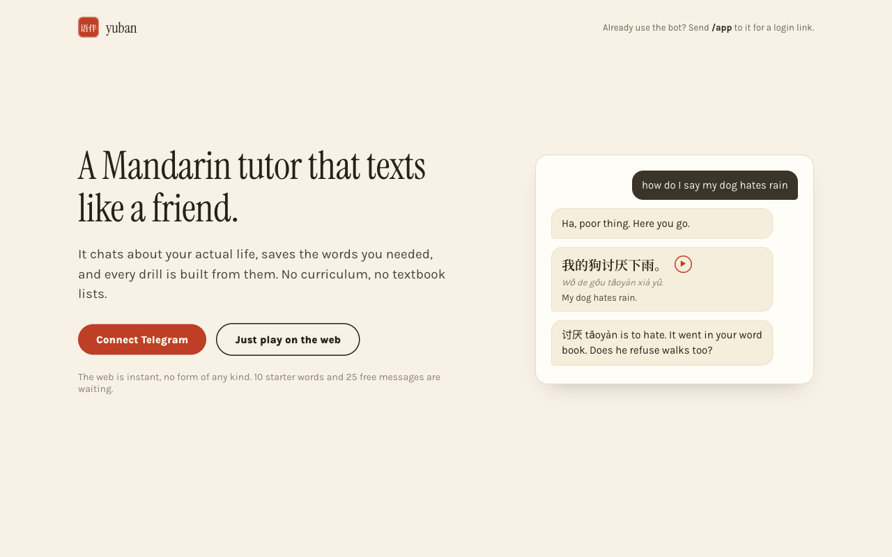
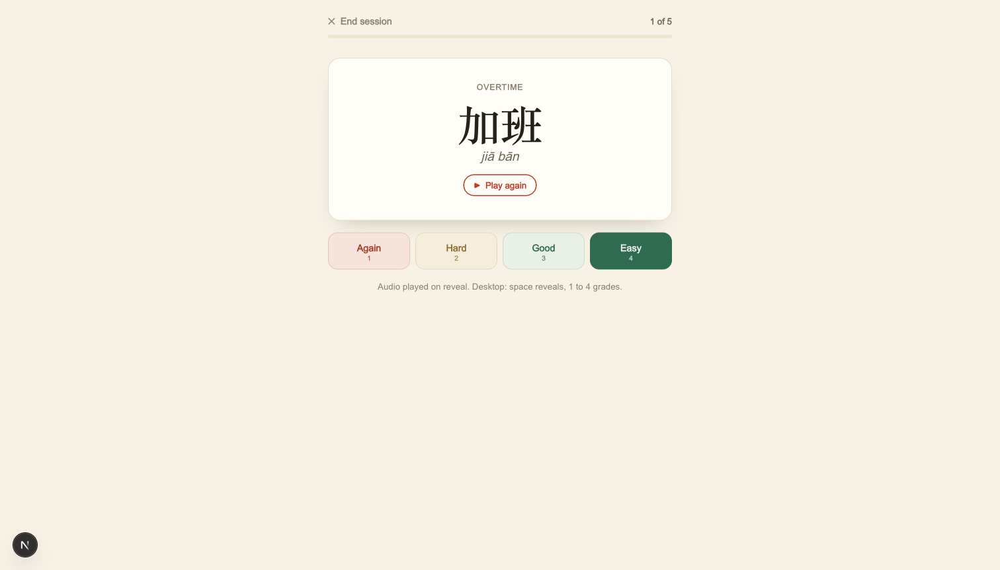
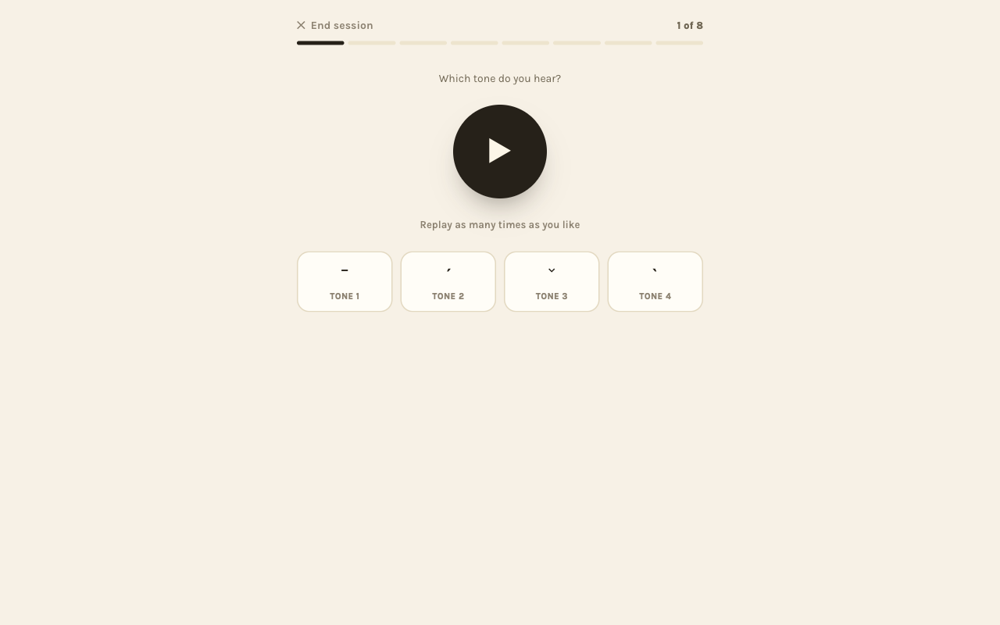

# 语伴 yuban

**A Mandarin tutor that texts like a friend.** It chats about your actual
life on web or Telegram, quietly saves the words you needed, and every
drill (flashcards, tone training, listening) is built from your own
vocabulary. No curriculum, no textbook lists, and the brain runs on a
laptop.

Built for the Build with Gemini Hackathon 2026, Singapore. Track: **Best
Use of Gemma**.



## Why full Gemma (the strategy, not just the track)

The tutor's brain is **Gemma 4 12B running fully local** via ollama (Q4
quantization, Metal GPU). This is a deliberate product foundation, chosen
over Gemini Flash 3.7 after benchmarking both:

- **Free forever is a wedge, not a discount.** Language learners are
  burned out on subscriptions. A genuinely free tier only survives scale
  if inference costs nothing, and only open weights make that possible.
  With a cloud model every free user is a growing bill (Gemini Flash's
  price doubles in January 2027 — a rug we would not control). With Gemma,
  $0 per message, forever.
- **Private by design.** People tell a tutor-friend about their crush,
  their job, their family. In yuban none of that leaves the machine. Kill
  the wifi and the tutor keeps teaching — that is the demo.
- **Speed was a false advantage.** Flash 3.7 answers in ~0.7s, local
  Gemma in ~2s. In a *texting* UX, two seconds behind a typing indicator
  feels more human, not less. We could not find a moment where the user
  would ever feel the difference — so we kept the model we can own.
- **What paying buys** is not the model, it's the relationship: the
  Telegram companion that checks in on you first. $20 for 30 rolling days,
  pure margin, because the marginal message costs zero.

### What building on Gemma actually taught us

Two findings from adapting Gemma 4 12B, both baked into the code:

1. **`think: false` is mandatory.** Ollama enables hidden reasoning by
   default for gemma4; a 4-line reply burned ~1100 reasoning tokens and
   took 38.5s. With thinking off, the same reply takes ~2s.
2. **Two-pass tool calling.** With the full ~3k-token persona loaded,
   gemma stopped emitting inline tool calls entirely (0 of 4 in live
   tests) while short prompts hit 100%. So gemma mode captures vocabulary
   the FunctionGemma way: a tiny post-reply extraction call with a short
   tool-only prompt, fired after the reply is already sent. Zero added
   latency, reliable word capture.

The whole engine sits behind one `chat()` seam, and an admin command
(`/engine gemma|deepseek`) can flip the product to a cloud model
mid-conversation — same memory, same persona. We keep it as a live A/B
that shows exactly what the open model buys. **Privacy first, not privacy
only**: on-device is the default, cloud is an opt-in switch.

### Which Gemma where (Gemma 4, April 2026 — the current generation)

Ollama is only the runtime: a local server that holds the open weights and
exposes an API. Swap the tag and the same product runs a different size.

| Tier | Model | Size (Q4) | Fits | Notes |
|---|---|---|---|---|
| Phone | Gemma 4 E2B | ~2.9 GB | modern phones | smallest; 128K ctx; native audio+vision input |
| Phone / thin laptop | Gemma 4 E4B | ~4.5 GB | phones, 8GB laptops | the mobile target; audio+vision input |
| Laptop (this demo) | **Gemma 4 12B** | ~6.7 GB | 16GB+ machines | what yuban ships; IFEval 97.2; ~2s replies on an M-series Mac |
| Laptop, quality bump | Gemma 4 26B-A4B | ~14.4 GB | 32GB+ machines | MoE, only 3.8B active per token — near-31B quality at small-model speed |
| Server | Gemma 4 31B | ~17.5 GB | GPU boxes | benchmark tier; IFEval 98.9 |

The mobile app is roadmap, not shipped: E4B via Google's AI Edge runtime is
the same architecture with smaller weights, so nothing in this codebase's
design changes — only the ollama endpoint does.

**Swapping sizes is two lines.** Bigger machine? Smaller one? Pull the tag
that fits and point the app at it:

```bash
ollama pull gemma4:26b            # or e2b / e4b / 12b / 31b
echo "GEMMA_MODEL=gemma4:26b" >> .env
docker compose up -d --force-recreate server
```

### Voice (also optional, also swappable)

With zero TTS keys the app speaks with Microsoft Edge's **Xiaoxiao**, a
native-Mandarin neural voice, free forever. Add an `ELEVENLABS_API_KEY`
and ElevenLabs (Sarah on `eleven_v3` by default) is tried first, falling
back to Xiaoxiao automatically on any failure — missing key, burned
monthly quota, or no network. Every clip is synthesized once and cached to
disk forever either way.

## What it does

**Chat — one brain, two doors.** The same conversation on the web app and
the Telegram bot, one shared history. The bot can also reach out first
("hey, just checking in") because a closed browser tab cannot. Every full
Mandarin sentence arrives as a tri-line — hanzi, tone-marked pinyin,
English — with native-voice audio a tap away.


**A word book that fills itself.** Words you actually needed get saved by
the model through tools, then scheduled by spaced repetition (strength
1–5 → review in 1/3/7/14/30 days). Today shows what's due, your streak,
and the freshest catches.


**Drills built only from your words.** Recall flashcards with self-grading
(keyboard on desktop: space reveals, 1–4 grades), a four-tone ear trainer,
and listening comprehension with sentences generated from your own
vocabulary.




**Small delights.** Hover any hanzi anywhere for instant pinyin. Audio is
a native Mandarin neural voice (Microsoft Edge TTS — free), synthesized
once and cached forever; one clip plays at a time, overlap is impossible.
Web guests get 10 starter words and 25 free tutor messages, then can link
Telegram and their whole account merges across.

## Stack

pnpm monorepo. `apps/server`: Express 4 + grammY Telegram bot + Prisma/
Postgres in one process; engines behind one `chat()` seam (Gemma via
ollama's native API, DeepSeek via OpenAI SDK). `apps/web`: Next.js 15,
warm-paper design system, motion built on LottieFiles motion-design
principles. STT: Groq Whisper (optional; falls back to "type it for me").
Docker compose for the whole stack.

## Run it

```bash
cp .env.example .env        # fill in TELEGRAM_BOT_TOKEN etc.
ollama pull gemma4:12b      # the local brain
docker compose up -d        # postgres + server + web
# open http://localhost:3000 and press "Just play on the web"
```

Tests: `pnpm -C apps/server test` (vitest, 21 tests: SRS math, subscription
logic, auth single-use, chat gating, dash scrubbing, and an LLM wire-body
regression test against a local capture server).

## Putting it on the internet

Running locally (above) is the developer path. For non-technical friends,
the simplest hosted shape is a tunnel to the machine that holds the model:

```bash
cloudflared tunnel --url http://localhost:3000
# then set WEB_ORIGIN=<the printed https url> in .env and restart the server
# container so magic links and the bot's /app button use the public URL
```

Visitors get the full product at that URL — guest accounts, chat, drills —
while inference stays on the host machine. If the host sleeps, the URL
stops answering; that outage IS the "server is down" state, so keep the
lid open (`caffeinate -s`) while sharing. A permanent deploy is the same
compose stack on any always-on box, with `OLLAMA_ORIGIN` pointed at
wherever the weights live.

**In-browser inference (roadmap, honestly).** True "website but on-device"
means WebGPU inference. As of today WebLLM ships no Gemma 4 builds (its
newest is Gemma 2 2B, too weak for Mandarin), so this needs either a
custom MLC compile or Google's MediaPipe runtime with self-hosted weights.
The engine seam is ready for it; the ecosystem isn't yet.

## Rights

Source is public for hackathon judging. All rights reserved.
