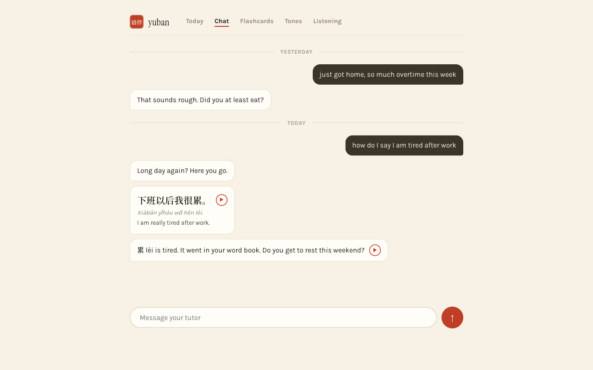
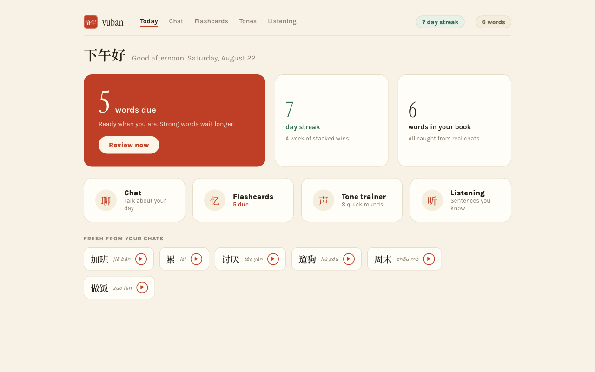

# 语伴 yuban

A Mandarin tutor that texts like a friend. It chats about your actual life
on web or Telegram, quietly saves the words you needed, and every drill is
built from your own vocabulary. No curriculum, no textbook lists. The brain
runs on a laptop.

Built for the Build with Gemini Hackathon 2026, Singapore. Track: Best Use
of Gemma.


## Why full Gemma

The tutor's brain is Gemma 4 26B-A4B running fully local via ollama. We
benchmarked Gemini Flash 3.7 against it and picked Gemma on purpose, not
for the track badge.

Free forever is a wedge, not a discount. Language learners are burned out
on subscriptions. A genuinely free tier only survives scale if inference
costs nothing, and only open weights make that possible. With a cloud
model every free user is a growing bill, and Gemini Flash's price doubles
in January 2027, which is a rug we would not control. With Gemma a message
costs zero, forever.

Private by design. People tell a tutor-friend about their crush, their
job, their family. None of that leaves the machine. Kill the wifi and the
tutor keeps teaching. That is the demo.

Speed turned out to be a false advantage. Flash answers in under a second,
local Gemma in about two. In a texting interface, two seconds behind a
typing indicator feels more human, not less. We could not find a moment
where the user would ever feel the difference, so we kept the model we can
own.

What paying buys is not the model, it is the relationship: the Telegram
companion that checks in on you first. $20 for 30 rolling days, and the
marginal message costs nothing.

### What building on Gemma taught us

Two findings from adapting Gemma 4, both baked into the code:

1. `think: false` is mandatory. Ollama enables hidden reasoning by default
   for gemma4. A four line reply burned about 1100 reasoning tokens and
   took 38.5 seconds. With thinking off, the same reply takes about two.
2. Two pass tool calling. With the full persona loaded (about 3k tokens),
   gemma stopped emitting inline tool calls entirely, zero out of four in
   live tests, while short prompts hit every time. So gemma mode captures
   vocabulary the FunctionGemma way: a small extraction call with a short
   tool-only prompt, fired after the reply is already sent. No added
   latency, reliable word capture.

The whole engine sits behind one `chat()` seam. An admin command,
`/engine gemma|deepseek`, flips the product to a cloud model mid
conversation with the same memory and persona. We keep it as a live A/B
that shows exactly what the open model buys. Privacy first, not privacy
only: on-device is the default, cloud is an opt-in switch.

### Which Gemma where

Gemma 4 (April 2026) is the current generation. Ollama is only the
runtime: a local server that holds the open weights and exposes an API.
Swap the tag and the same product runs a different size.

| Tier | Model | Size (Q4) | Fits | Notes |
|---|---|---|---|---|
| Phone | gemma4:e2b | ~2.9 GB | modern phones | smallest; 128K context; audio and vision input |
| Phone or thin laptop | gemma4:e4b | ~4.5 GB | phones, 8GB laptops | the mobile target; audio and vision input |
| Laptop | gemma4:12b | ~6.7 GB | 16GB+ machines | IFEval 97.2; about 2s replies on an M-series Mac |
| Laptop, quality bump | gemma4:26b | ~14.4 GB | 32GB+ machines | MoE with 3.8B active per token; near-31B quality, replies under a second warm. What this demo ships. |
| Server | gemma4:31b | ~17.5 GB | GPU boxes | benchmark tier; IFEval 98.9 |

The mobile app is roadmap, not shipped. E4B through Google's AI Edge
runtime is the same architecture with smaller weights, so nothing in this
codebase changes except the endpoint.

Swapping sizes is two lines. Bigger machine? Smaller one? Pull the tag
that fits and point the app at it:

```bash
ollama pull gemma4:12b            # or e2b / e4b / 26b / 31b
echo "GEMMA_MODEL=gemma4:12b" >> .env
docker compose up -d --force-recreate server
```

### Voice, also optional, also swappable

With no TTS keys the app speaks with Microsoft Edge's Xiaoxiao, a native
Mandarin neural voice, free forever. Add an `ELEVENLABS_API_KEY` and
ElevenLabs (Sarah on `eleven_v3` by default) is tried first, falling back
to Xiaoxiao automatically on any failure: missing key, burned monthly
quota, no network. Every clip is synthesized once and cached to disk
either way.

## What it does

Chat is one brain with two doors. The same conversation lives on the web
app and the Telegram bot with one shared history. The bot can also reach
out first ("hey, just checking in") because a closed browser tab cannot.
Every full Mandarin sentence arrives as a tri-line of hanzi, tone-marked
pinyin, and English, with audio a tap away.



The word book fills itself. Words you actually needed get saved by the
model through tools, then scheduled by spaced repetition: strength 1 to 5
maps to review in 1, 3, 7, 14, or 30 days. Today shows what is due, your
streak, and the freshest catches.



Drills are built only from your words: recall flashcards with self grading
(space reveals, 1 to 4 grades on desktop), a four tone ear trainer, and
listening comprehension with sentences generated from your own vocabulary.


Small things that matter: hover any hanzi anywhere for instant pinyin, one
audio clip plays at a time so overlap is impossible, and web guests get 10
starter words plus 25 free tutor messages, then can link Telegram and
their whole account merges across.

## Stack

pnpm monorepo. `apps/server` is Express 4, the grammY Telegram bot, and
Prisma on Postgres in one process, with engines behind one `chat()` seam
(Gemma through ollama's native API, DeepSeek through the OpenAI SDK).
`apps/web` is Next.js 15 with a warm paper design system and motion built
on LottieFiles motion design principles. Voice notes transcribe through
Groq Whisper when a key is present, and the bot asks you to type when it
is not. Docker compose runs the whole stack.

## Run it

```bash
cp .env.example .env        # fill in TELEGRAM_BOT_TOKEN etc.
ollama pull gemma4:12b      # the local brain, pick your size from the table
docker compose up -d        # postgres + server + web
# open http://localhost:3000 and press "Just play on the web"
```

Tests: `pnpm -C apps/server test`. 21 vitest cases covering SRS math,
subscription logic, auth single-use, chat gating, dash scrubbing, and an
LLM wire-body regression test against a local capture server.

## Putting it on the internet

Running locally is the developer path. For friends who do not use a
terminal, the simplest hosted shape is a tunnel to the machine that holds
the model:

```bash
cloudflared tunnel --url http://localhost:3000
# then set WEB_ORIGIN=<the printed https url> in .env and restart the
# server container so magic links and the bot's /app button use it
```

Visitors get the full product at that URL, guest accounts and chat and
drills included, while inference stays on the host machine. If the host
sleeps, the URL stops answering, and that outage is the "server is down"
state. Keep the lid open with `caffeinate -s` while sharing. A permanent
deploy is the same compose stack on any always-on box with `OLLAMA_ORIGIN`
pointed at wherever the weights live.

In-browser inference is roadmap, honestly. True "website but on-device"
means WebGPU inference in the visitor's browser. As of today WebLLM ships
no Gemma 4 builds (its newest is Gemma 2 2B, too weak for Mandarin), so
this needs either a custom MLC compile or Google's MediaPipe runtime with
self hosted weights. The engine seam is ready for it. The ecosystem is
not, yet.

## Rights

Source is public for hackathon judging. All rights reserved.
